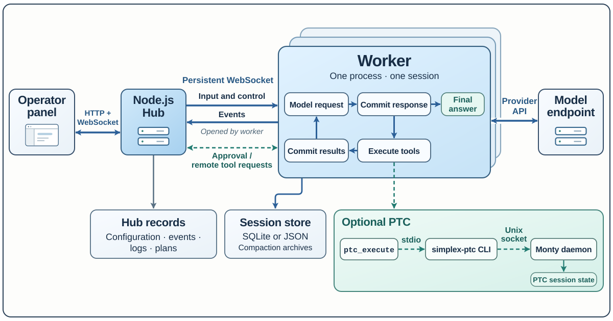

# Architecture

Simplex pairs a Node.js Hub with a native C++ worker. The Hub serves the web
panel and supervises sessions. Each worker process owns one session and runs its
agent loop. A single Hub can manage several workers, each with its own
conversation state.

<a :href="architectureDiagram">View the diagram at full size</a>

## Services and startup

The Hub launches `simplex run` locally, in a configured Docker container, or on a
remote host over SSH. A worker can also be launched independently and connected
to a service that implements the worker protocol. See the
[Hub deployment guide](../deployment/hub.md) and the guides for
[Docker](../deployment/docker-worker.md) and [remote workers](../deployment/remote-worker.md).

At startup, the worker validates configuration, restores or initializes session
state, and assembles the driver model, tool registry, and loop-hook registry.
Both built-in and configured plugin components can participate. The worker
refreshes the runtime prompt with the skills of the registered tools before
accepting requests. See [plugin configuration](../plugins/configuration.md).

## Process communication

The browser uses HTTP and a WebSocket to interact with the Hub. Each worker
opens its own persistent, reconnecting WebSocket to the Hub. The Hub sends
requests and control signals on this connection, and the worker sends lifecycle
and execution events back. Optional approvals and remote tool requests use
separate, one-shot WebSocket connections, also opened by the worker. The worker's
provider adapter calls the configured model endpoint directly. See the
[worker connection contract](../core/worker-protocol.md#connections-and-configuration).

## Agent loop

The worker runs one request at a time. After admitting a message or a
continuation, it calls the driver model with the current conversation and
commits the complete response. If the response asks for tools, the registry
applies the tool approval policy, dispatches the calls, and returns a result for
each call. The loop commits those results before requesting the model again.
Synchronous hooks can observe loop boundaries or edit eligible state, such as
pruning past tool output after a batch. See the [loop hook guide](../plugins/loop-hooks.md).

A response with a final answer and no tool calls completes ordinary work.
With the default `empty_advance` behavior, a response containing only reasoning
or no content advances to another exchange. When enabled,
[automatic compaction](../core/worker-protocol.md#automatic-context-compaction)
can summarize the context and continue the same user request.

Cancellation interrupts a pending model request. The loop lets already
dispatched tool calls settle and records their outcomes. External effects may
remain after cancellation. The
[recovery phases](../core/worker-protocol.md#cancellation-shutdown-and-recovery)
determine whether a later message or continuation can proceed.

## Programmatic tool calling

With [Programmatic Tool Calling (PTC)](../plugins/ptc.md), the model writes a
Python program that calls tools and submits it through `ptc_execute(source)`. The worker applies its
normal tool approval policy and invokes the separately installed `simplex-ptc`
CLI over standard input and output. The CLI talks to a local daemon over a Unix
socket. The daemon uses Pydantic Monty to execute a Python subset with configured
functions, including shell commands and text editing.

PTC requires worker persistence and has its own interpreter state under
`<persistence.directory>/ptc/`. Committed state can survive subsequent calls,
worker restarts, and conversation compaction. The worker configuration selects
which PTC and native toolsets are available together.

## State and persistence

The worker owns the authoritative conversation in `AgentInputState`, including
messages, tool results, and loop progress. With persistence enabled, a
session-scoped store saves state on the worker target. SQLite is the default for
new empty sessions. Existing JSON sessions can keep using full JSON snapshots.
See [backend selection and backups](persistence-backends.md).

The worker checkpoints before tool dispatch and again after complete results
return. Recovery can commit saved results to the conversation without calling
the tools again. If tool effects are uncertain, the worker blocks progression
pending operator inspection. Restoring a session waits for a new request before
starting inference.

[Compaction](../core/worker-protocol.md#compact-conversation-context) archives the
original state and replaces the conversation turns with a summary in the
model's memory. The worker records checkpoints and archives through its selected
backend. The Hub maintains separate configuration, event, log, and plan records
for supervision and display. For managed sessions it invokes
[`simplex manage`](../reference/management.md) on the worker target to inspect
saved state.
